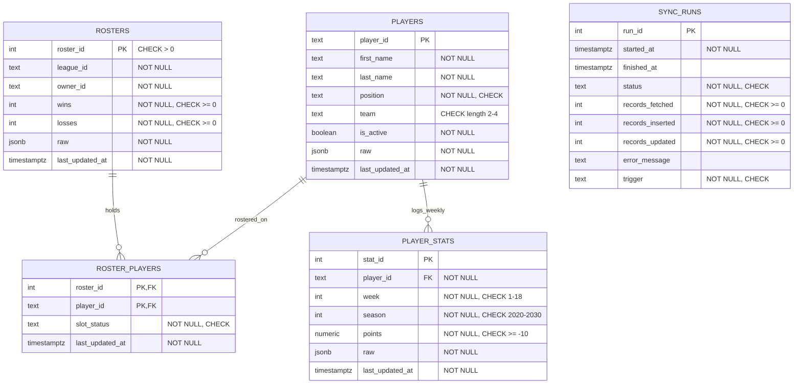

# Database Schema & Entity-Relationship Diagram

## Table Descriptions

- **Players**: Stores NFL player metadata (player_id natural key from Sleeper), standardized positions, active team status, and raw JSON payloads.

- **Rosters**: Stores fantasy league team records, manager identifiers, and win/loss standings.

- **Roster_Players**: (Many-to-Many Junction Table): Resolves the many-to-many relationship between fantasy rosters and NFL players so each roster holds a realistic ~15–20 players (starter, bench, ir, or taxi) rather than joining league-wide player_stats directly onto rosters.

- **Player_Stats**: Stores weekly fantasy point totals per player and season (UNIQUE (player_id, week, season)), preventing duplicate weekly rows on reload.

- **Sync_Runs**: Audit table recording each ingestion run's start/end timestamps, status, row counts, and trigger source. 

### Design Decision Justification
 
- **Decision**: We debated whether to store player weekly performance statistics inside a flattened JSON column directly within the players table versus creating a normalized relational child table (`player_stats`), and whether to attach roster membership directly onto stats/players versus a dedicated join table (`roster_players`).

- **Justification**: We chose to normalize performance metrics into a separate `player_stats` table with an explicit foreign key to `players` (`player_id`) and a unique `(player_id, week, season)` key, while modeling roster membership via a many-to-many `roster_players` table (`roster_id` and `player_id`) so rosters hold realistic ~15–20 player lineups instead of inflating league-wide stats onto every team. This supports multi-variable business queries across weeks and seasons while keeping a `raw` `jsonb` column on core tables to capture unmodeled API fields.

## Access roles
SELECT COUNT(*) FROM players;
Result: (9422,)

> DELETE FROM players WHERE player_id = 'nonexistent';
Expected Error: permission denied for table players

> INSERT INTO players (player_id) VALUES ('test');
Expected Error: permission denied for table players

All read-only enforcement checks completed successfully!